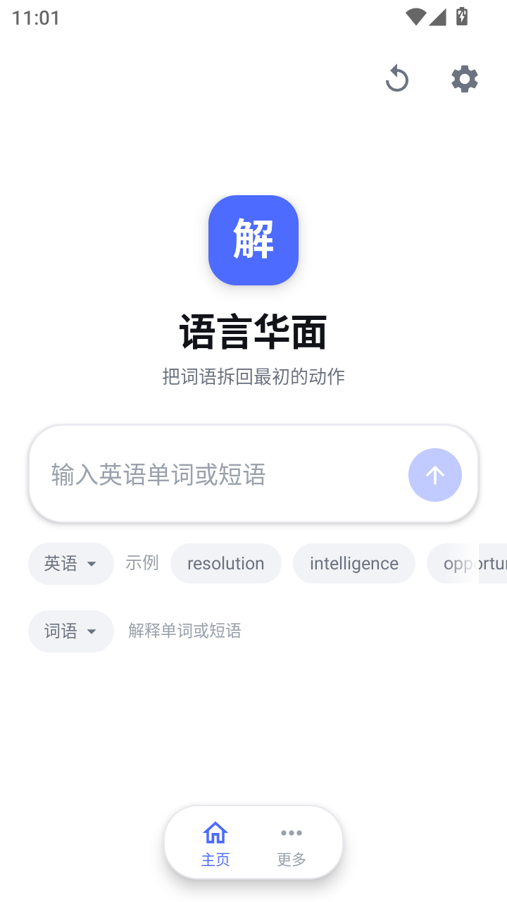
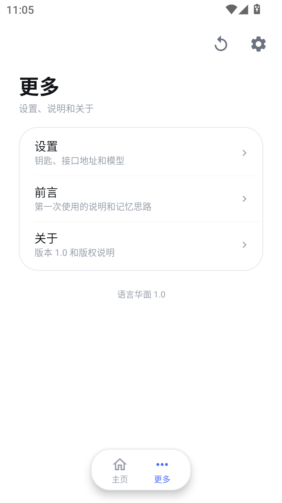
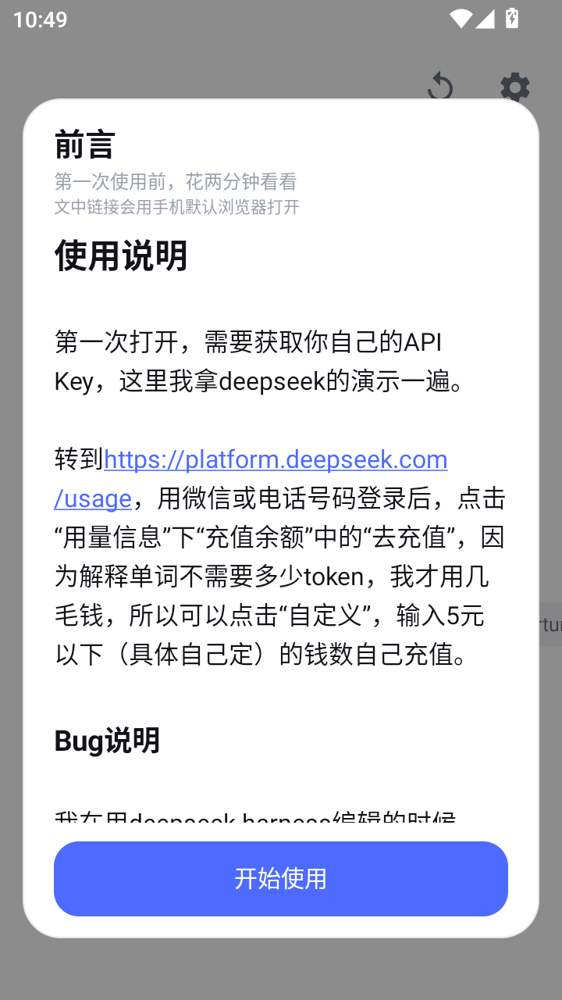

# 语言华面 · Android

输入一个词语或一段语言用法，App 按一套固定方法把它拆开、还原到原始动作，并生成「速记锚点」和完整解释。支持英语、俄语、西班牙语、法语、德语、日语、文言文；也能切换到「语言用法」模式，像母语者一样解释语法和用法。查过的词保存在这台手机，只有你点红色垃圾桶并确认才会删除。

## 预览

## 安装

- 手机：把 `语言华面.apk` 发到手机，点开安装；系统提示“未知来源”时允许一次。
- 模拟器：把 APK 拖进模拟器安装，或执行 `adb install 语言华面.apk`。

## 第一次使用

1. 输入框下面左侧是语言切换，默认「英语」。点一下会向下展开七种语言，选哪个就切换到哪个。
2. 再下面一行是解释模式，默认「词语」。点一下会向右展开「单词短语 / 语言用法」。
3. 点中间输入框，输入对应语言的单词、短语，或一个语言用法题目，按键盘上的搜索键。
4. 没查过：联网生成（约十几秒）；查过：直接打开上次的解释。
5. 生成新词需要先填 DeepSeek 钥匙：右上角齿轮 → 填 `sk-` 开头的钥匙 → 保存。
6. 没有钥匙也能用：点输入框下面的「示例」，每种语言都内置了示例词（文言文有「犹」「将」）。

## 前言

- 安装后第一次打开，会先弹出「前言」，内容来自 `docs/使用方法.docx`，包括 API Key、充值和记忆思路。
- 点文中的 DeepSeek 链接，会用手机默认浏览器打开；手机没有浏览器时会提示打不开。
- 点「开始使用」进入主界面；之后不再自动弹出。

## 底部导航

- 主界面底部居中：房屋图标 + 「主页」，三个点图标 + 「更多」。
- 当前页的图标和文字是蓝色，另一页是灰色。
- 点图标或文字切换；在页面上向左滑到「更多」，向右滑回「主页」。
- 「更多」页里有设置、前言和关于；右上角的设置齿轮位置不变。
- 输入查询时底部导航会收起，退回主界面后恢复。

## 语言

- 英语、俄语、西班牙语、法语、德语、日语、文言文。
- 切换语言后，输入提示、示例词、查询历史都会跟着切换。
- 查询历史按语言分开保存；切回某门语言，就能看到该语言查过的词。
- 文言文的结果页会多一段「演化史」，写清字形本义、假借或引申支路、时代和现代残留。

## 解释模式

- 「词语」：解释单词或短语。
- 「语言用法」：解释虚拟语气、完成时这类用法；先写母语者心里在做什么，再列常见类型、相关词汇和几个独立场景，不套课堂句型公式。
- 语言用法也会保存进查询历史，和单词历史混在一起按时间排列，前面带「用法 ·」。

## 发音

- 英语结果页在单词下面显示英式 DJ、美式 KK 音标；点旁边的喇叭播放。
- 其他语言显示读音（假名、转写或拼音），同样可以点喇叭播放。
- 音标参考墨墨背单词的 DJ/KK 写法；音频来自有道词典。模拟器测试时记得打开 MuMu 和 Windows 的音量。

## 批量查询

输入多个词语时，用任意标点分隔即可，例如：

`comfortable, deal, where` 或 `comfortable；deal；where`

App 会拆成多个词，依次生成并存入历史，然后打开「批量解释」页；点已完成的词查看结果。

## 首页最近查询

- 示例后面会跟「历史」，单词和语言用法按时间从新到旧混在一起。
- 用法前面标「用法 ·」，颜色比示例浅一点。
- 示例 + 历史最多 10 个；放不下的在点开输入框后的「最近查询」里还能看到（最多 40 条）。
- 这一行可以左右滑；英语有 6 个示例，历史在示例后面，往左滑就能看到。
- 点历史里的任意一项，直接打开上次的结果。

## 界面

- 首页：中间长条输入框；输入框下方是语言和模式切换，示例和历史也在这里。
- 点输入框：输入框滑到最顶端，最近查询像窗帘一样落下；单词和语言用法混排。每行从左到右是：描边垃圾桶、灰色复制图标、词/用法、锚点。点垃圾桶 →「确认删除？」→ 取消 / 确认（红色）；点复制图标会把词复制到剪贴板。
- 结果页：速记锚点、拆解、原始动作、根源画面、初意、抽象义、例句、简短画面；原始动作和根源画面里的中心句会加粗；右上角可以复制。
- 从结果页退出：如果这个结果是从「批量解释」点进来的，先回批量解释；批量解释再退回查询界面；查询界面再退回主界面。单次查询则直接从结果页回查询界面，再回主界面。
- 结果页右上角的转圈箭头是「重新生成」，会用新格式重新解释当前词并覆盖这条记录，点之前会先确认。
- 字体、深色模式都跟随系统。

## 保存与重启

- 语言、解释模式、输入框里的内容都会保存，下次打开还是上次离开时的样子。
- 右上角齿轮左边的转圈箭头是「重启」：点一下会先确认，然后清空输入、语言和模式，回到初始状态；历史记录和钥匙不会删。

## 注意

- 生成解释需要联网 + 你自己的 DeepSeek 钥匙；钥匙只存本机，不会发到别处。
- MuMu 模拟器如果软键盘不弹出，是模拟器关闭了软键盘；用电脑键盘直接输入即可，真机会正常弹出。
- 内容由 AI 生成，仅供学习参考。

## 目录

- `app/`：Android 源码（Java + 资源 + assets）
- `build.ps1`：aapt2 → javac → d8 → zipalign → apksigner 构建脚本
- `语言华面.apk`：已打包安装包
- `docs/screenshots/`：界面截图
- `docs/使用方法.docx`：前言原文

## 开发者

- 源码：`app/`
- 构建：`build.ps1`（需自备 JDK 17、Android SDK 34 和 build-tools 34.0.0；脚本默认找 `toolchain/`，没有就改脚本里的路径）
- 产物：`out/jieci.apk`；仓库根目录的 `语言华面.apk` 是已打包版本
- 包名：`com.dsh.jieci`；minSdk 24；targetSdk 34；数据库版本 3（单词和语言用法分开存，首页合并显示）
- 前言内容：`app/assets/editorial.json`（从 `docs/使用方法.docx` 提取；弹窗代码在 `EditorialDialog.java`）
